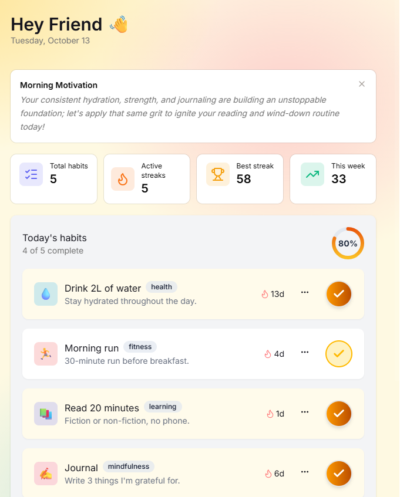
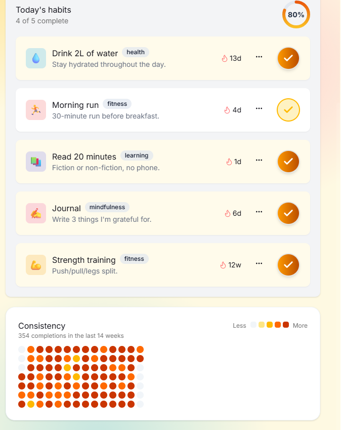
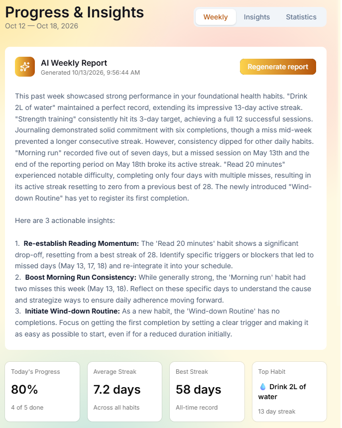
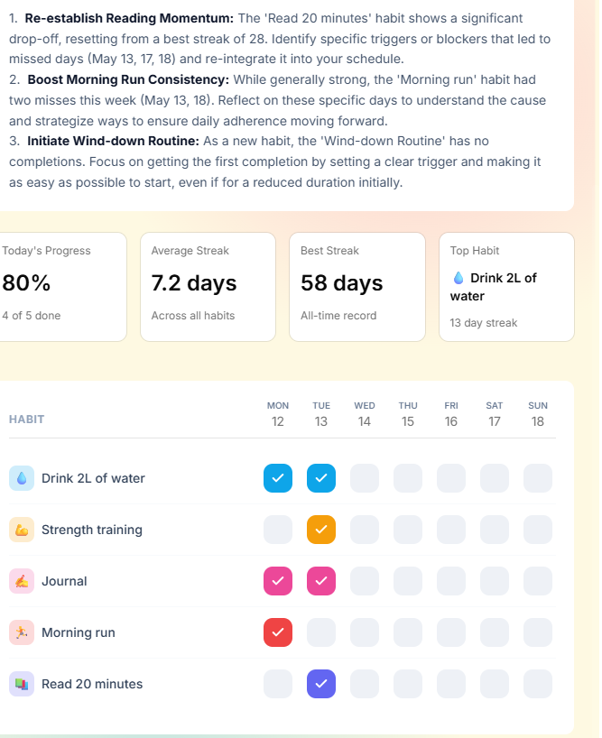
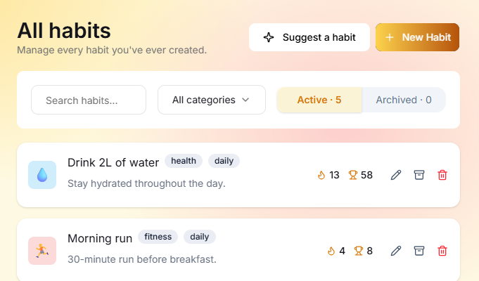

a habit tracker named Nudge.

page 1.
today:

page 2.
progress

settings modal:
we still need to figure this out.

page 3. habits

we somehow need this to show all system habits that i can add pluse my custom habits.

several habit categories.

when tapping a habit in today page, it toggles complete / incomplete
